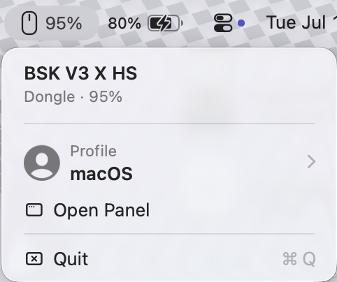
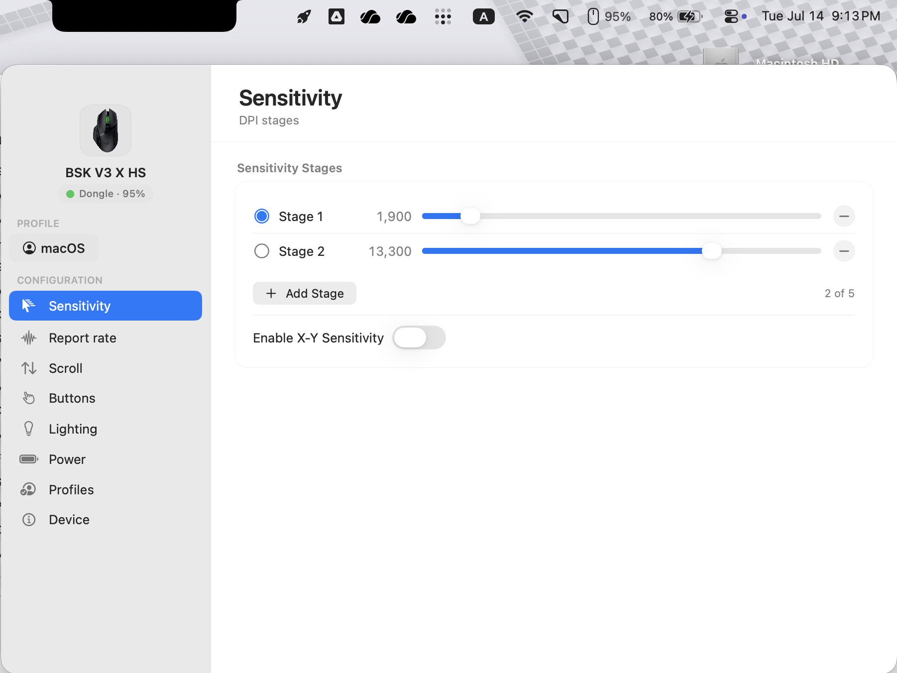
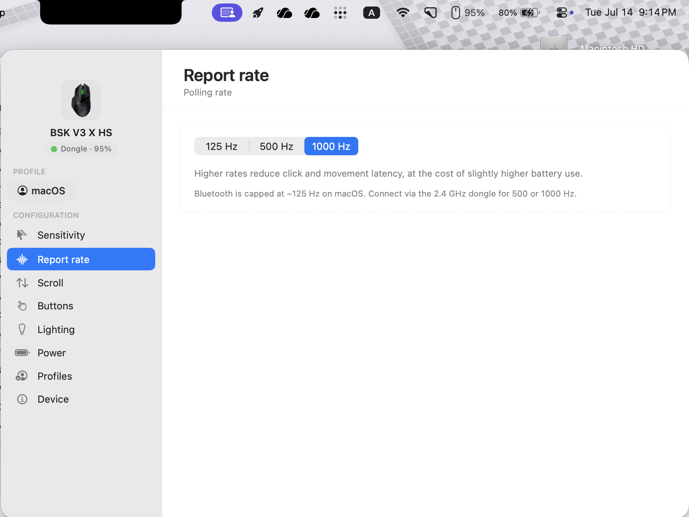
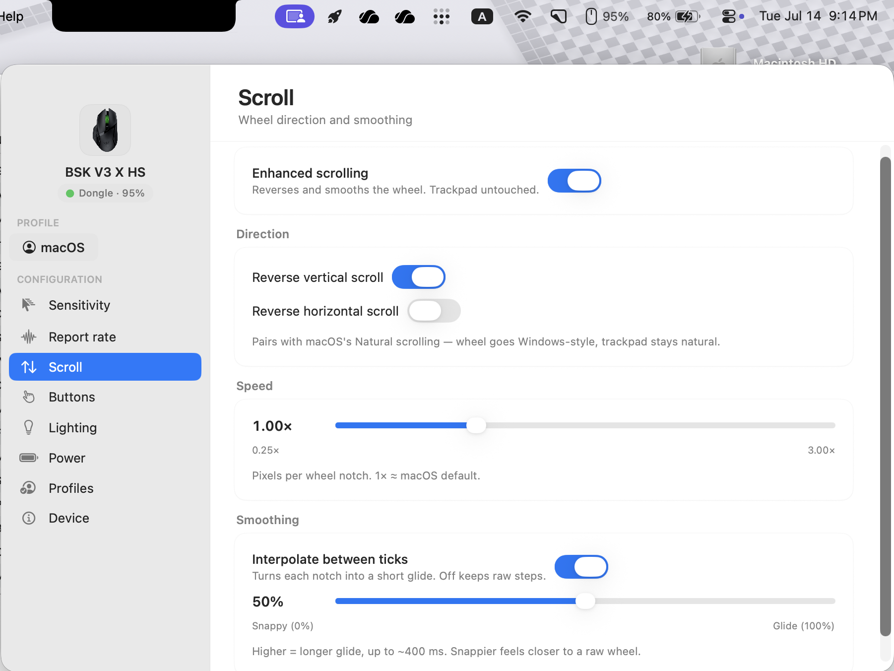
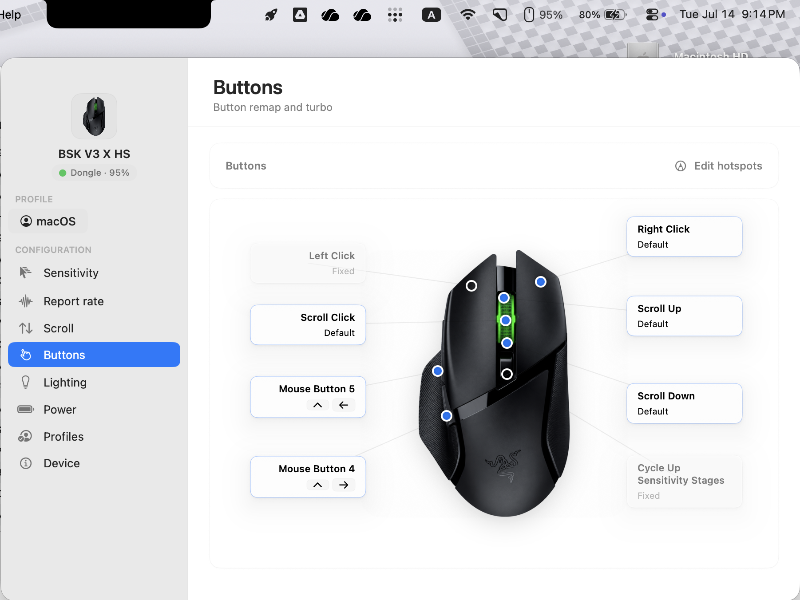
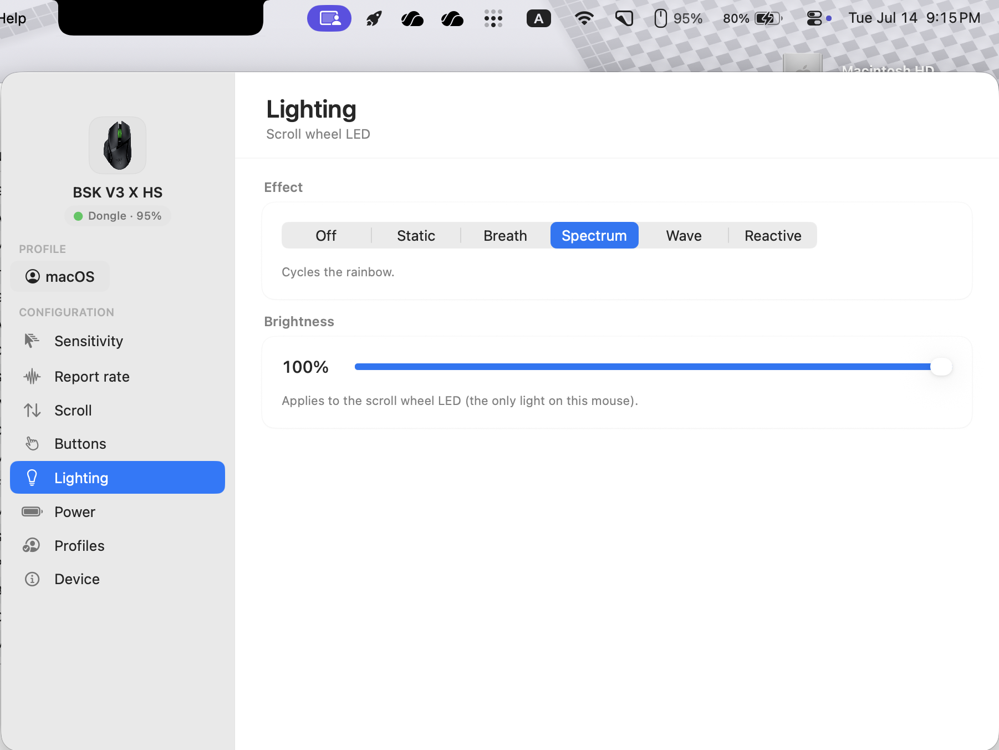
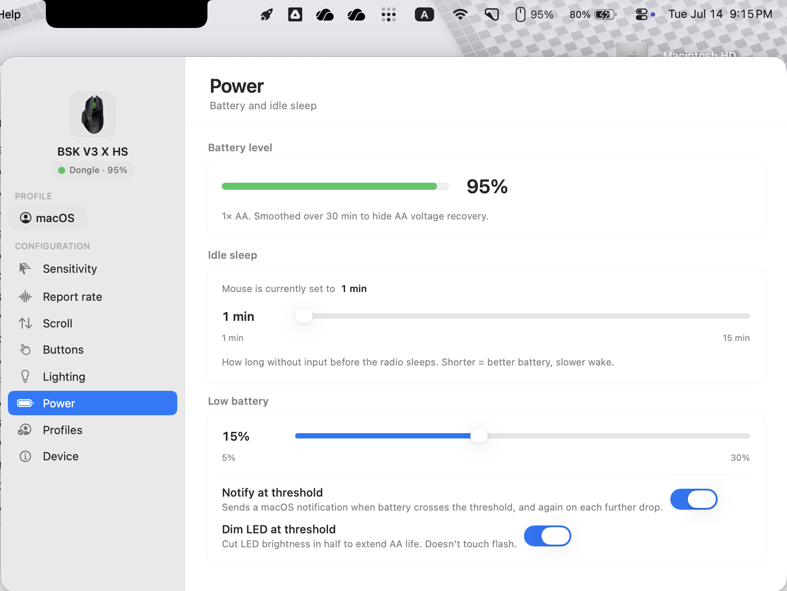
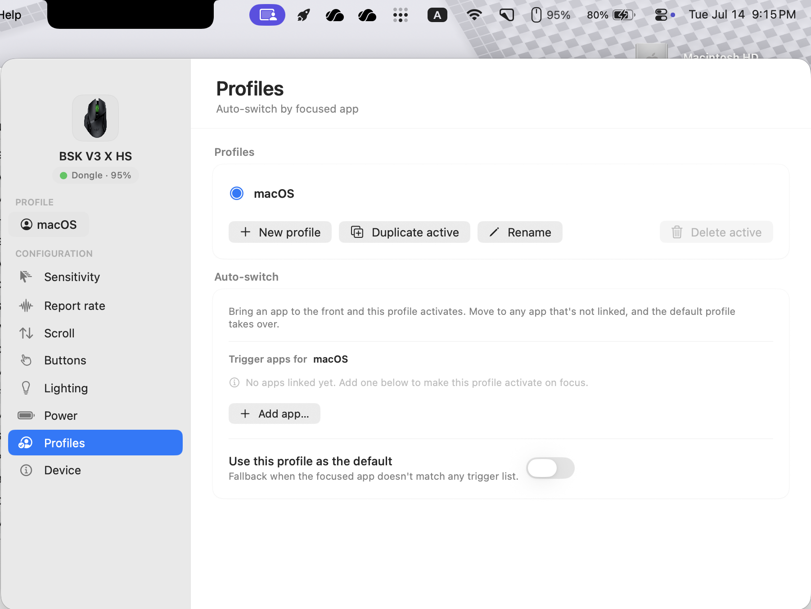
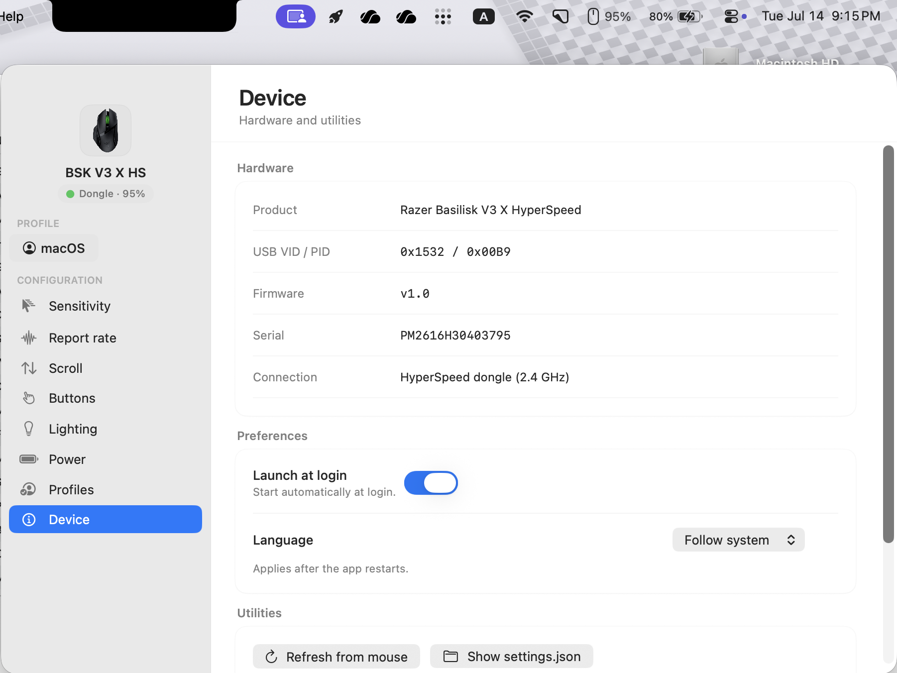

<h1 align="center">Razer BSK V3 X HS on Mac</h1>

<p align="center">
  在 Mac 上配置 Razer Basilisk V3 X HyperSpeed 的开源原生 app。<br/>
  DPI、回报率、按键重映射、灯效、滚动增强、电量、按前台程序自动切换 profile —— 不需要 Synapse。
</p>

<p align="center">
  <a href="#安装">安装</a> ·
  <a href="#功能">功能</a> ·
  <a href="#权限">权限</a> ·
  <a href="#从源码构建">编译</a> ·
  <a href="README.md">English</a>
</p>

---

## 简介

Razer 官方 Synapse 至今没有 Basilisk V3 X HyperSpeed 的 macOS 版本，这
个 app 就是为了填这个坑。所有写入都是 **onboard memory**，配置在鼠标
断电、拔插 dongle、切到 Windows 之后都还在。

<p align="center">
  
</p>

---

## 截图

| 灵敏度 | 回报率 |
|:---:|:---:|
|  |  |

| 滚轮 | 按键 |
|:---:|:---:|
|  |  |

| 灯效 | 电量 |
|:---:|:---:|
|  |  |

| Profile | 设备 |
|:---:|:---:|
|  |  |

---

## 功能

- **灵敏度** —— 最多 5 个 DPI 档位（100–18000 dpi），每档独立 X/Y，
  鼠标物理 DPI 键的切换同步反映到 UI
- **回报率** —— 2.4 GHz dongle 下 125 / 500 / 1000 Hz（Bluetooth 下
  macOS 限制到 ~125 Hz）
- **滚轮** —— 每轴独立反向，速度倍率，~100–400 ms 滑行平滑。Bluetooth
  下也能用。触控板完全不动。
- **按键** —— 右键 / 滚轮键 / 侧键可映射成键盘快捷键、鼠标点击、多媒体键、
  DPI 切换、启动 URL / app / 命令行、输入文字、按住 Modifier 组合、Boss
  key。Turbo（连点）1–60 Hz per 按键。
- **灯效** —— 滚轮 LED 效果（Static / Breath / Spectrum / Wave / Reactive），
  全 RGB、Wave 方向、Reactive 速度。拖动时只写 RAM 不占 flash 寿命。
- **电量** —— 30 分钟窗口平滑（避免 AA 电池电压回升假高读数）、Idle-sleep
  时长带写入校验、可配置低电量阈值 + 系统通知 + LED 自动降亮度。
- **Profile** —— 按前台程序自动切换（把 bundle ID 绑到 profile），可配
  default profile 兜底。可导入 / 导出 `.bskprofile.json`。
- **设备** —— Firmware、序列号、VID/PID、开机启动、语言（跟随系统 /
  English / 简体中文）、从鼠标 refresh、显示 settings.json、导出/导入
  profile。
- **菜单栏** —— 图标空闲时暗、有输入时亮。旁边的电量数字从三条路里选
  最新的显示（Razer vendor 协议、BLE GATT、Apple IOPowerSources）。

---

## 安装

1. 到
   [Releases](https://github.com/AaronKhoolb/Razer-BSK-V3-X-HS-on-Mac/releases)
   下载最新的 `Razer-BSK-V3-X-HS-<版本>.app.zip` 或 `.dmg`。
2. 解压 zip / 打开 dmg 拖到 `/Applications`。
3. 首次打开：右键 app → **打开**（绕过 Gatekeeper 的"未验证"警告），
   或者跑一次：
   ```
   xattr -dr com.apple.quarantine "/Applications/Razer BSK V3 X HS.app"
   ```
4. 授权 *Input Monitoring* 和 *Accessibility*（下面详细讲）—— vendor
   命令和按键重映射才能到鼠标。

要求：macOS 14 (Sonoma) 或更新，Apple Silicon。

---

## 权限

- **Input Monitoring** —— 通过 dongle 发 HID feature report 用的
  （DPI、回报率、灯效、休眠、电量）。
- **Accessibility** —— 按键重映射和滚动平滑用的（都走 CGEventTap）。
- **蓝牙**（可选）—— 当 dongle 没接的时候，用来读 BLE 电量。
- **通知**（可选）—— 低电量提醒用的。

如果哪个面板缺权限，app 里会显示一张卡片 + "Grant" 按钮直接跳到对应
设置页。

如果你是自己跑 `setup-cert.sh` 编译的，签名身份跨编译稳定，macOS
的权限授权不会失效。下载的 ad-hoc 签名版本每次重新签名 hash 都会变，
所以重签之后需要重新授权。

---

## 从源码构建

```bash
git clone https://github.com/AaronKhoolb/Razer-BSK-V3-X-HS-on-Mac.git
cd Razer-BSK-V3-X-HS-on-Mac

# 一次性：生成一个本地自签的 code-signing cert，重复编译时 TCC 权限
# 不会失效。不需要 Apple Developer 账号。
bash setup-cert.sh

# 编译
bash build.sh

# 运行
open "build/BSK V3 X HS.app"
```

---

## 商标声明

**Razer™、Basilisk™、HyperSpeed™** 都是 Razer USA Ltd. 的商标。本项目
和 Razer 没有任何关联、赞助或授权。产品名只是为了指明这个 app 支持的
是哪一款设备。完整免责声明和第三方致谢见 [NOTICE.md](NOTICE.md)。

---

## 许可证

MIT —— 见 [LICENSE](LICENSE)。

---

## 贡献者

<a href="https://github.com/AaronKhoolb/Razer-BSK-V3-X-HS-on-Mac/graphs/contributors">
  
</a>
